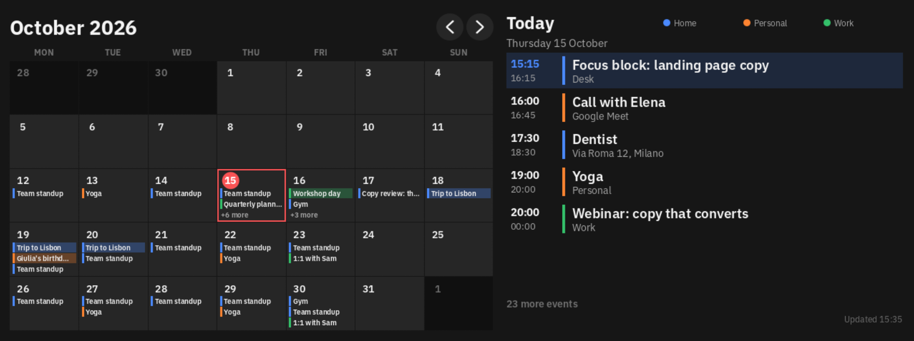
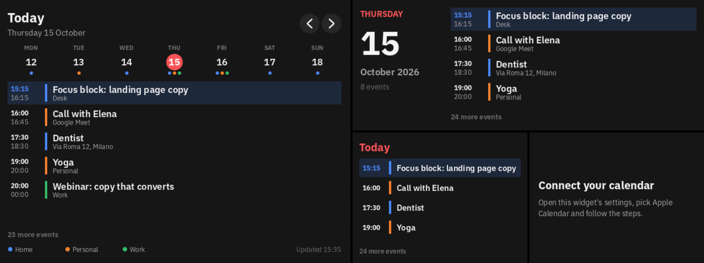
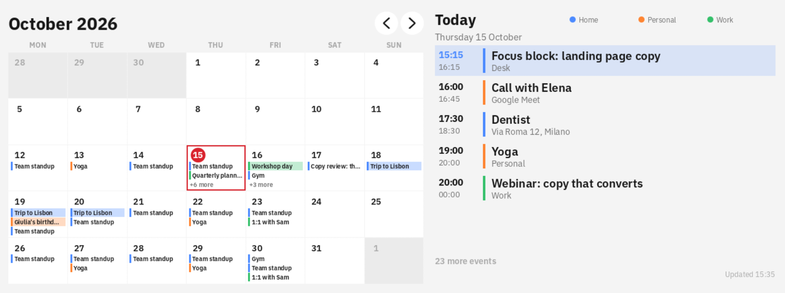

# Deck Calendar for the Braiins Deck

Your calendars on the Braiins Deck: a month grid with the day's list beside it, and smaller layouts for
the Deck's other tile sizes. It reads Apple (iCloud), Google, Outlook (Outlook.com and Microsoft 365),
Proton, Fastmail, Nextcloud and anything else that publishes an iCalendar (`.ics`) link, up to three
calendars at once, each in its own colour. It only reads; it never changes your events.



- **Pick the service, get the steps.** The Deck can't sign in to an account, so each calendar is
  connected through the private link its service publishes. Until one is connected, the tile shows the
  steps for the service you chose.
- **Recurring events done right.** Weekly and monthly events, exceptions, moved and cancelled
  occurrences, all-day and multi-day events, and time zones (Outlook's Windows zone names too).
- **Works offline.** The last events it got are saved, so they show at once after a reboot and while
  the Deck has no network.
- **Light on the Deck.** The calendar file is read a slice at a time, so even a 4 MB feed with
  thousands of old events never stalls the screen.

## What you need

- A Braiins Deck whose firmware runs **widget SDK 0.6**. Check with the command below; it should
  print `widget SDK version 0.6.0`. The Deck shows its IP when you swipe down on its screen.

  ```bash
  ssh root@<deck-ip> "grep -m1 -o 'widget SDK version [0-9.]*' /var/log/bmc/run-bmc-wasm-host-sdk-v0.log"
  ```

- Root SSH login to the Deck with a key. If you can log in with a password, set that up once with
  `ssh-copy-id root@<deck-ip>`.
- A Mac or Linux computer with git, [Git LFS](https://git-lfs.com), [Rust](https://rustup.rs) and
  python3. The pinned Rust version installs itself on the first build.

## Install

```bash
git lfs install
git clone --recurse-submodules https://github.com/elliotalderson95/braiins-deck-calendar.git
cd braiins-deck-calendar
./deploy.sh <deck-ip>
```

Then add **Deck Calendar** to a scene in the Deck's web interface and connect a calendar (below).
Remove the widget with `./undeploy.sh <deck-ip>`.

## Connecting a calendar

The link a service publishes for a calendar works like a password for reading it, so the Deck keeps it
as an account (under **Connected Accounts**), never in the widget's settings, which end up in support
archives.

1. Get the calendar's link:
   - **Apple:** iPhone Calendar, Calendars, the (i) beside the calendar, turn on **Public Calendar**, tap
     **Share Link**, Copy. On a Mac: right-click the calendar, Share Calendar, Public Calendar, Copy Link.
     The link starts with `webcal://`; change that to `https://`.
   - **Google:** calendar.google.com on a computer, Settings (the gear), the calendar under *Settings for
     my calendars*, **Integrate calendar**, copy the **Secret address in iCal format**.
   - **Outlook:** Outlook on the web, Settings, Calendar, Shared calendars, **Publish a calendar**, pick
     the calendar and *Can view all details*, Publish, copy the **ICS** link. Microsoft refreshes
     published calendars only every few hours, and some work accounts can't publish.
   - **Proton, Fastmail, Nextcloud, others:** the calendar's sharing or export settings, an iCalendar
     (ICS) or subscription link.
2. **Connected Accounts**, **Add New Account**, keep the type **Token**, name it, and paste the link as the
   token. Optionally add the service's host (such as `calendar.google.com`) under *Allowed destinations*.
3. Add **Deck Calendar** to a scene. In its settings pick the service, then pick the account for
   **Calendar 1 link**. Calendars 2 and 3 work the same way.

A link that doesn't work says why on the tile (the link is gone, it opens a web page, the service can't
be reached). To see the widget working before using a private calendar, add Google's public Italian
holidays as the token (it is public, so it is no secret):
`https://calendar.google.com/calendar/ical/it.italian%23holiday%40group.v.calendar.google.com/public/basic.ics`

## Layouts

| Tile | What it shows |
| --- | --- |
| Full (1280 x 480) | The month, with each day's events, and the selected day's list. Tap a day, or the arrows. |
| Large (638 x 480) | A strip of the week above the list. Tap a day, or the arrows to move by a week. |
| Medium (638 x 238) | The day's date beside its events. Tap to move on to the next day with events. |
| Small (317 x 238) | A short list. Tap to move on to the next day with events. |



A picked day goes back to today after 90 seconds. Events already over are dimmed, and left out when the
list is short of room; the one under way is highlighted.



## Settings

For each of the three calendars: the service, an optional name (otherwise the calendar's own name), and
its colour. Also: the look (dark, light, or light by day and dark at night) and how often to check for
changes (every 5, 15, 30 or 60 minutes). The Deck's own settings decide the timezone, 12 or 24 hour
clock, date order and first day of the week.

## How it works

- **Fetch.** The widget asks for the link with the credential placeholder as the whole URL, so the Deck
  puts the secret in as the request leaves and the widget never holds it. Redirects aren't followed for
  such requests (a Deck rule), so use the final link.
- **Read.** A frame has about ten million instructions, and a busy calendar's file is megabytes of mostly
  past events. `ics.rs` reads the file a slice at a time: line ends a word at a time, branching on a
  property's length and first letter, skipping alarms, attendees and descriptions without copying, and
  decoding an event's text only once the event is known to fall in the window (last month's grid to next
  month's). A 4 MB feed with 9,000 events costs under 3M instructions in its heaviest frame.
- **Time.** The Deck's widget host has the timezone database and the recurrence engine, so the widget
  asks it (`zones.rs`): to turn a zoned time into an instant (Outlook's Windows zone names are mapped to
  IANA names first), and to repeat repeating events, which the widget then trims for exceptions
  (`EXDATE`), moved occurrences (`RECURRENCE-ID`) and cancelled ones.
- **Show.** `model.rs` places every occurrence on the Deck's own calendar days; `view.rs` draws.
- **Keep.** The events are saved (`kv`) after each refresh, so they show at once after a reboot and
  while the Deck is offline. A failing calendar is retried after 1, 2, 5, 10 and 15 minutes.

Limits: 10 MiB per calendar file (a Deck rule), 4,000 events read per calendar, 800 occurrences per
calendar and 1,500 in all (the nearest to now are kept), and `RDATE` lists aren't used.

## Develop

The widget is Rust compiled to WebAssembly, built against the Braiins Deck SDK in `bmc-sdk/`. That is a
submodule of [BraiinsForge/bmc-main](https://github.com/BraiinsForge/bmc-main), pinned to the SDK 0.6
commit. The pure logic is tested natively, with the crates the Deck's host uses (`rrule`, `chrono-tz`)
standing in for it:

```bash
cargo test -p deck-calendar
```

To see it on a Mac, run the mock calendar server (Apple, Google and Outlook style feeds with dates
relative to today, a 4 MB feed, a web page, a 404) and the SDK's desktop testbed. The testbed can't save
an account, so the dev-only features `preview-links`, `preview-errors`, `preview-failed` and `preview-big`
point the three calendars at the mock instead; `preview-grid` draws the three smaller layouts inside the
full tile, which the testbed shows whole; `preview-spin` and `profiling` fill the testbed's perf report
with per-section instruction counts.

```bash
cargo build --manifest-path bmc-sdk/Cargo.toml -p bmc-wasm-runtime --features testbed --bin testbed
tools/mock-calendar.py &
cargo build -p deck-calendar --target wasm32-unknown-unknown --features preview-links,preview-grid
bmc-sdk/target/debug/testbed --platform bmc100 --manifest deck-calendar/manifest.json \
  target/wasm32-unknown-unknown/debug/deck_calendar.wasm
```

To find out why a real feed misbehaves, save it to a file and see what the widget would make of it
(which events it keeps, how many frames it takes, what it would show from a given day):

```bash
ICS_FILE=feed.ics TODAY=2026-10-15 cargo test -p deck-calendar a_feed_from_a_file -- --ignored --nocapture
```

After changing the widget, bump `version` in both `deck-calendar/manifest.json` and
`deck-calendar/Cargo.toml`, then run `./deploy.sh <deck-ip>`. The Deck restarts the widget with the new
version. If the manifest changes, regenerate the typed params:

```bash
cargo build --manifest-path bmc-sdk/Cargo.toml -p bmc-widget-codegen
bmc-sdk/target/debug/bmc-widget-codegen --manifest deck-calendar/manifest.json \
  --out deck-calendar/src/manifest_params.rs
```

## License

GPL-3.0-or-later; see [COPYING](COPYING). The widget is built with the Braiins Deck SDK, which is
GPL-3.0-or-later. `deck-calendar/testdata/google-holidays-it.ics` is a small excerpt of Google's public
Italian holidays calendar, used only as test data. The events in the screenshots are made up.

This is an independent project, not made or endorsed by Braiins, Apple, Google or Microsoft.
